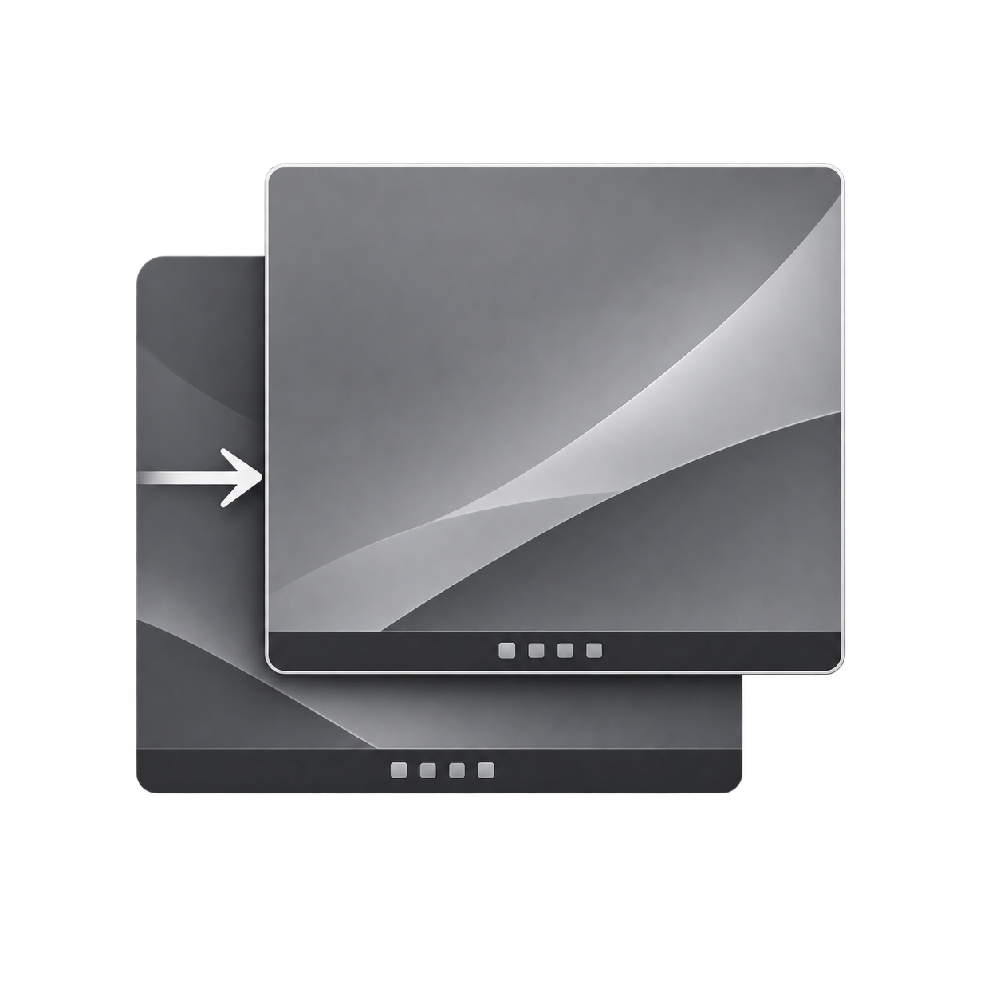

<p align="center">
  
</p>

<h1 align="center">LiteDesktopSwitcher</h1>

<p align="center">
  用 <kbd>Alt</kbd> + <kbd>1</kbd> 到 <kbd>Alt</kbd> + <kbd>9</kbd> 直接切换 Windows 虚拟桌面。<br>
  <a href="README.en.md">English</a>
</p>

后台静默运行，没有主窗口和托盘图标，不联网，也不用装 AutoHotkey 或额外的运行库。适用于 64 位 Windows 10 和 Windows 11（依赖系统自带的 .NET Framework 4.x）。

## 下载与运行

1. 前往 [GitHub Releases](https://github.com/munamizi/LiteDesktopSwitcher/releases/latest) 的 **Assets** 下载 `LiteDesktopSwitcher.exe`。
2. 把它放到常用目录，双击运行即可。

> 程序暂未签名，首次运行可能触发 Windows SmartScreen 的未知发布者提示，确认来源后放行即可。

## 使用说明

按 `Win+Tab` 可以查看或新建虚拟桌面。`Alt+1` 到 `Alt+9` 对应任务视图里从左到右的桌面顺序，最多支持前 9 个桌面。

程序只会注册当前已有桌面对应的快捷键（例如只有 4 个桌面时，只注册 `Alt+1` 到 `Alt+4`）。运行期间新增或删除桌面，热键范围会自动更新，不用重启程序。

- **开机自启**：按 `Win+R` 输入 `shell:startup`，把 `LiteDesktopSwitcher.exe` 的快捷方式放进打开的文件夹。
- **退出与更新**：在任务管理器中结束 `LiteDesktopSwitcher.exe`。程序为单实例运行，更新前先结束旧进程，再替换文件并启动，否则新版本会直接退出。
- **快捷键冲突**：如果某个 `Alt+数字` 已被其他软件占用，程序会弹窗提示。等对应快捷键释放后，程序会自动重试注册。

## 排查问题

遇到切换失效或异常时，可以先查看运行日志：

```text
%LOCALAPPDATA%\LiteDesktopSwitcher\LiteDesktopSwitcher.log
```

也可以带上 `--self-test` 参数做一次自检。自检会检查桌面列表、COM 接口和热键注册机制，并在程序同目录下生成 `LiteDesktopSwitcher.selftest.txt`，过程中不会实际切换桌面：

```powershell
.\LiteDesktopSwitcher.exe --self-test
```

## 实现原理

整个程序由单个 C# 文件编译成 64 位 EXE，分两个线程工作：

- **热键线程**：调用 Win32 `RegisterHotKey` 监听全局热键，收到 `Alt+数字` 后将目标桌面编号交给后台线程，避免阻塞按键响应。
- **切换线程**：通过注册表跟踪桌面数量变化，优先调用 Windows 的虚拟桌面 COM 接口直接跳转。如果 COM 接口重试后依然失败，程序会在确认当前桌面位置的前提下，改用系统的 `Win+Ctrl+←/→` 逐步切换并逐次核对位置。

> Windows 虚拟桌面 COM 接口并未公开，后续系统大版本更新后可能需要跟进适配。

## 从源码编译

不需要安装 Visual Studio 或下载第三方包。在仓库根目录运行 `build.ps1`，脚本会直接调用系统自带的 64 位 .NET Framework 编译器（`csc.exe`）：

```powershell
.\build.ps1
```

---

采用 [MIT 许可证](LICENSE)。快捷键交互思路参考了 [choyy/VirtualDesktopSwitcher](https://github.com/choyy/VirtualDesktopSwitcher)，相关版权声明见 [THIRD_PARTY_NOTICES.md](THIRD_PARTY_NOTICES.md)。
